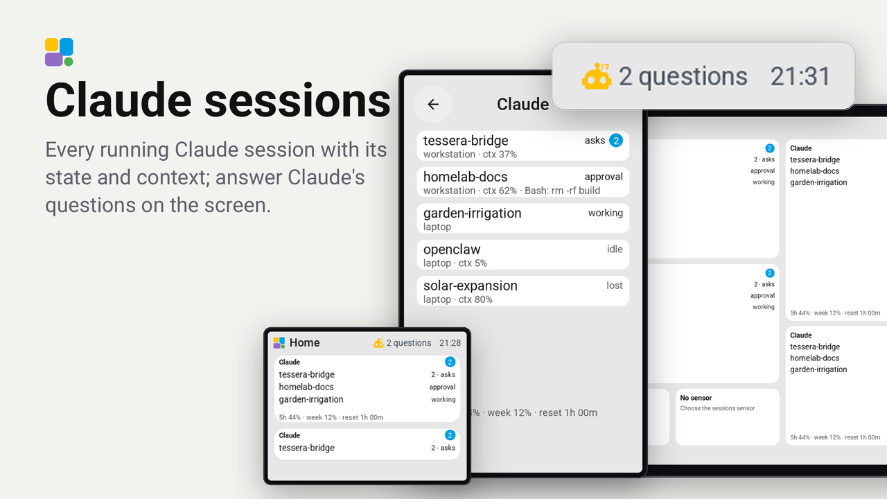
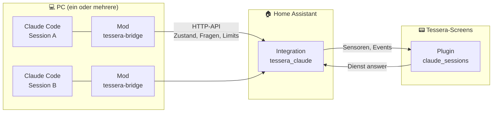
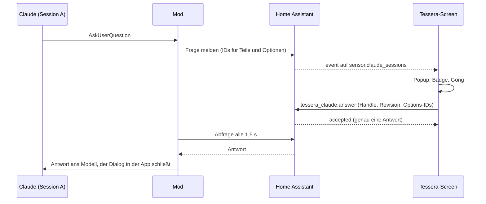

<div align="center">

# tessera-bridge

**Alle laufenden Claude-Code-Sessions auf den Tessera-Touchscreens in Home Assistant – und Claudes Fragen direkt am Screen beantworten.**




</div>

---

## Was es kann

- 🖥️ **Jede Session im Blick** – arbeitet sie, wartet sie auf eine Antwort oder auf eine Freigabe, wie voll ist ihr Kontext? Von einem oder mehreren Rechnern, auch Sessions im Hintergrund der Desktop-App.
- 👆 **Fragen am Screen beantworten** – stellt Claude eine Auswahlfrage (AskUserQuestion), erscheint sie als Popup. Ein Tipp beantwortet sie in der richtigen Session. Das klappt mit mehreren Teilen, mit Mehrfachauswahl und mit **Am PC**, wenn der Rechner übernehmen soll.
- 🏁 **Genau eine Antwort zählt** – PC und Screen, zwei Screens oder ein Doppeltipp: Home Assistant entscheidet, wer zuerst war. Die anderen Dialoge schließen sich von selbst.
- 🔔 **Freigabe-Hinweise** – wartet eine Session am PC auf eine Freigabe, zeigt der Screen einen Hinweis. Antworten musst du am PC.
- 📊 **Limits des Kontos** – 5-Stunden- und Wochen-Limit mit Reset-Zeit, als Sensoren und auf einer eigenen Kachel mit Balken und Tempo-Marke. Die Option „Fenster“ zeigt beide Fenster, nur 5 Stunden oder nur die Woche.
- ⏱️ **Aktivität** – ob Claude gerade arbeitet, seit wann und in wie vielen Sessions. Wartet eine Frage, wird die ganze Kachel rot. Dazu eine kleine Animation zur Wahl (Mosaik bauen, Mosaik-Fresser, Claude-Funke oder keine), die arbeitet, schläft und wartet.
- 🧵 **Hintergrund-Aufgaben** – Shells, Agents, Monitore und Workflows, die im Hintergrund laufen, mit ihrer Startzeit. Unter jeder Aufgabe steht ein Balken, der kürzer wird, je mehr erledigt ist (die Schritte meldet der Agent selbst). Ein Tipp öffnet eine Karte mit Schritt und Notiz.
- 🔊 **Ansage wählbar** – auf Wunsch spielt Chime TTS einen Gong und liest die Frage vor (Sprachausgabe), spielt nur den Gong (Signalton) oder schweigt (nichts). Am Screen und in Home Assistant einstellbar.

## Die drei Teile



| Teil | Ordner | Aufgabe |
|---|---|---|
| **Mod** `tessera-bridge` | `hooks/`, `.claude-plugin/` | Ein Claude-Code-Mod für die Desktop-App (Code-Tab) oder das Terminal. Jede Session, die ihn lädt, meldet sich unter eigener ID bei Home Assistant: Zustand, Kontext, Limits, offene Fragen (mit IDs für jeden Teil und jede Option) und Hintergrund-Aufgaben. Antwortet ein Screen, gibt der Mod die Antwort an das Modell weiter. Antwortet der PC, meldet er das an Home Assistant. |
| **Integration** `tessera_claude` | `custom_components/tessera_claude/` | Das Register in Home Assistant für Sessions, Fragen, Limits und Hintergrund-Aufgaben. Sie entscheidet, wer zuerst geantwortet hat, stellt Sensoren und Dienste mit Antwort bereit, feuert Events für Automationen und spielt Gong und Sprachausgabe ab. |
| **Tessera-Plugin** `claude_sessions` | `tessera-plugin/claude_sessions/` | Ein normales Tessera-Plugin mit drei Kacheln, Sessions-Karte, Frage-Karte, Popup und einem Element für die obere Leiste. |

Mehrere Sessions dürfen gleichzeitig fragen, auch von verschiedenen Rechnern. Gleiche Titel oder Optionen kommen sich nicht in die Quere, weil nichts über den Text zugeordnet wird.

## Am Screen

| Kachel | Größen | Zeigt |
|---|---|---|
| **Claude-Sessions** | 1×1 bis 3×3 | Die Sessions mit ihrem Zustand und die offenen Fragen als Badge. Ab zwei Zeilen Höhe stehen die Limits in der letzten Zeile. Ein Tipp öffnet die Sessions-Karte. |
| **Claude aktiv** | 1×1 bis 2×2 | Ob Claude arbeitet, seit wann und in wie vielen Sessions. Wartet eine Frage, ist die Kachel rot; ein Tipp öffnet die Frage. Option „Animation“: Mosaik bauen, Mosaik-Fresser, Claude-Funke oder keine. Auf einer breiten Kachel nimmt die Animation die rechte Hälfte. |
| **Claude-Limits** | 1×1 bis 3×2 | 5-Stunden- und Wochenlimit als Balken, mit Tempo-Marke (wo ein gleichmäßiger Verbrauch stünde) und Reset. Meldet Claude Code ein Modellfenster (z. B. Fable), kommt es als eigener Balken dazu. Option „Fenster“: beide, 5 Stunden oder Woche. Ein einzelnes Fenster sieht aus wie eine native Meter-Kachel, mit Reset-Countdown oben rechts. So ersetzen zwei 1×1-Kacheln die beiden nativen Kacheln samt „Reset in“. |
| **Claude im Hintergrund** | 1×1 bis 3×3 | Was im Hintergrund läuft (Shell, Agent, Monitor, Workflow), das Neueste zuerst, jeweils mit Startzeit und ab zwei Spalten mit Laufzeit. Unter jeder Aufgabe ein Balken: kürzer, je mehr erledigt ist (Schritte aus dem Agent), sonst kürzer, je älter sie ist. Farbe nach Alter: Akzent, ab 1 Stunde gelb, ab 4 Stunden rot. Ein Tipp öffnet die Karte „Claude im Hintergrund“ mit „Schritt a von b · Notiz“ oder „kein Fortschritt gemeldet“. Auf 1×1 nur die Anzahl und „seit“ der ältesten Aufgabe. |

Dazu kommen:

- **Sessions-Karte** – jede Session mit Rechner, Kontext und dem, worauf sie wartet, seitenweise.
- **Frage-Karte** – die Optionen als Tasten. Mehrere Teile kommen nacheinander, bei Mehrfachauswahl gibt es eine Senden-Taste, dazu **Am PC**.
- **Popup** bei einer neuen Frage oder einer wartenden Freigabe. Beides lässt sich in den Plugin-Einstellungen abschalten, die Schalter „Frage als Popup“ und „Freigabe als Popup“ wirken sofort, auch wenn du sie in Home Assistant umlegst.
- **Einstellungszeile „Ansage“** – Sprachausgabe, Signalton oder nichts. Es ist derselbe Wert wie die Option der Integration.
- **Claude-Fragen** für die obere Leiste: die Zahl der offenen Fragen.

## Einrichten

### 1. Home Assistant: die Integration

HACS → Integrationen → benutzerdefiniertes Repository `https://github.com/magicx78/tessera-bridge` (Kategorie Integration) hinzufügen. Alternativ `custom_components/tessera_claude` nach `/config/custom_components/` kopieren.

Home Assistant neu starten. Dann unter Einstellungen → Geräte & Dienste → Integration hinzufügen → **Tessera Claude** auswählen.

Alle Felder im Formular sind optional:

- ein `media_player` für Gong und Sprachausgabe (dafür muss Chime TTS installiert sein)
- der Gong
- eine `tts`-Entität
- die Sprache
- die Ansage: Sprachausgabe, Signalton oder nichts
- ob eine Freigabe angesagt wird

Später lässt sich das alles unter **Optionen** ändern.

Unter **Optionen** gibt es ab Integration 0.2.8 außerdem **Erlaubte Nutzer** (`allowed_users`). Bleibt die Liste leer, darf jeder HA-Nutzer die Dienste und die HTTP-API aufrufen, wie bisher. Steht dort jemand, dürfen nur diese Nutzer und Administratoren. Aufrufe ohne Nutzer (Automationen, Skripte, Geräte-Aktionen) bleiben vorerst erlaubt. Jeder Aufrufer wird einmal ins Log geschrieben („Caller of tessera_claude: …“), so lassen sich die Nutzer des Screens und des Mods ablesen, bevor man die Liste füllt. Wer abgewiesen wird, steht einmal als Warnung im Log.

Danach in deinem Home-Assistant-Profil unter **Sicherheit** ein langlebiges Zugriffstoken für den Mod anlegen.

### 2. Claude Code: der Mod

In einer Claude-Code-Session (Desktop-App mit Code-Tab oder Terminal, ab v2.1.287):

```
/plugin marketplace add magicx78/tessera-bridge
/plugin install tessera-bridge@tessera-bridge
```

Danach die Optionen setzen, unter `/plugin` → Installed → tessera-bridge:

| Option | Bedeutung | Standard |
|---|---|---|
| `haUrl` | Adresse von Home Assistant, so wie dieser Rechner sie erreicht, ohne `/` am Ende | `http://homeassistant.local:8123` |
| `haToken` | das langlebige Token. Ist es leer, bleibt der Mod aus. | – |
| `instanceName` | Name dieses Rechners in der Sessions-Liste | leer |
| `sessionName` | Name für die Sessions dieser Installation. Bleibt er leer, wird der Projektordner genommen. | leer |
| `permissionHints` | `on`: wartende Freigaben werden am Screen als Hinweis gezeigt | `on` |
| `hintDelay` | So viele Sekunden muss eine Freigabe-Anfrage am PC offen sein, bevor der Hinweis kommt. | `8` |

In offenen Sessions danach `/reload-plugins` ausführen oder neue Sessions starten. Hintergrund-Aufgaben melden nur Sessions, die mit Mod 0.2.2 oder neuer gestartet wurden. Den Fortschritt eines Agents melden nur Sessions ab Mod 0.2.4; er kommt aus den Schritt-Werkzeugen `mcp__clawd-hq__step` und `mcp__savvy-progress__step`, die der Agent in seiner Schleife aufruft. Ab Mod 0.2.5 liest der Mod sie aus der Antwort des Modells, denn mit Mod 0.2.4 kamen sie in einer echten Session nie an. Er zählt außerdem die übrigen Werkzeug-Aufrufe eines Agents (`bg_calls` ab Integration 0.2.6), auch wenn der Agent keine Schritte meldet. Ab Mod 0.2.9 bewegt ein Schritt den Balken erst, wenn das Schritt-Werkzeug ihn angenommen hat; einen abgelehnten Schritt (etwa eine Notiz über 80 Zeichen) zeigt der Balken nicht mehr.

Willst du nur für eine Session einen Checkout laden, geht das mit `claude --plugin-dir /pfad/zu/tessera-bridge`.

### 3. Tessera: das Plugin

Plugins → **Mit Link hinzufügen** → `https://github.com/magicx78/tessera-bridge/tree/main/tessera-plugin/claude_sessions`. Alternativ den Ordner als Testordner nach `/config/tessera-plugins/claude_sessions/` kopieren.

Das Plugin einem Screen hinzufügen. Fragt Tessera nach dem Sessions-Sensor, `sensor.claude_sessions` wählen. Der Screen wird danach einmal gebaut.

Im Layout die Kacheln platzieren, sie stehen in der Gruppe Plugins:

| Kachel | Sensor |
|---|---|
| **Claude-Sessions** | `sensor.claude_sessions` |
| **Claude aktiv** | `sensor.claude_sessions` |
| **Claude-Limits** | `sensor.claude_sessions` |
| **Claude im Hintergrund** | `sensor.claude_background` |

Mehr steht in [`tessera-plugin/claude_sessions/README.de.md`](tessera-plugin/claude_sessions/README.de.md).

## In Home Assistant

### Sensoren

| Entität | Inhalt |
|---|---|
| `sensor.claude_sessions` | Anzahl der Sessions, die gerade melden. Die Attribute enthalten die Listen für den Screen: Namen, Zustände, Kontext, Fragen, Aktivität und Limits. `notify` ist die gewählte Ansage (`speech`, `tone`, `none`). |
| `sensor.claude_questions` | offene Fragen |
| `sensor.claude_limit_5h` | 5-Stunden-Limit in % |
| `sensor.claude_limit_week` | Wochen-Limit in % |
| `sensor.claude_5h_reset` | Zeit bis zum Reset des 5-Stunden-Fensters, z. B. „1h 09m“ |
| `sensor.claude_limits` | weitere Limit-Arten, falls das Konto welche meldet |
| `sensor.claude_background` | Anzahl der Hintergrund-Aufgaben. Die Attribute `bg_titles`, `bg_kinds`, `bg_sess`, `bg_at`, `bg_hm`, `bg_done` (-1: unbekannt) und `bg_total` (0: unbekannt) enthalten die Einzelheiten, das Neueste zuerst. |

### Dienste und Events

- **Dienste** (mit Antwort): `tessera_claude.get_overview`, `tessera_claude.get_question`, `tessera_claude.get_hint`, `tessera_claude.get_background`, `tessera_claude.set_notify` (`mode`: `speech`, `tone` oder `none`) und `tessera_claude.answer`. Das Plugin ruft sie über die Tessera-App auf.
- **Events** für eigene Automationen, etwa einen eigenen Gong oder eine Push-Nachricht: `tessera_claude_question` bei einer neuen Frage, `tessera_claude_hint` bei einer wartenden Freigabe.

## So reist eine Frage



War der PC schneller, meldet der Mod das bei der Integration an. Kam der Screen dort noch früher an, bekommt das Modell die Antwort vom Screen.

## Gut zu wissen

- **Freitext** tippt man nicht am Screen. Bei so einer Frage zeigt der Screen nur die Auswahl, und **Am PC** gibt sie an den Rechner ab.
- **Freigaben** wie „Darf ich diesen Befehl ausführen?“ werden nie am Screen beantwortet. Das Popup ist nur ein Hinweis.
- **Auto-Modus und „Berechtigungen umgehen“:** Im Auto-Modus beantwortet der Klassifizierer die meisten Anfragen selbst; ein Hinweis kommt erst, wenn er eine Anfrage an dich weitergibt. Mit umgangenen Berechtigungen fragt niemand, also gibt es keinen Hinweis, und eine Auswahlfrage, die die App nach ein paar Sekunden selbst beantwortet, wird nicht angesagt. Bleibt sie länger als zehn Sekunden offen, kommt sie auf den Screen.
- **Sessionname:** Bleibt `sessionName` leer, heißt die Session wie ihr Projektordner, auch wenn die Desktop-App sie in einem Ersatzordner gestartet und erst danach ins Projekt gesetzt hat.
- **„getrennt“** steht bei einer Session, deren Mod nicht mehr meldet, etwa weil der PC schläft oder das Netz weg ist. Nach zehn Minuten verschwindet sie.
- **Limits** gehören dem Konto. Sie gelten für alle Sessions gleich und werden nie zusammengezählt. Es zählt der Wert der Session, die zuletzt gemessen hat.
- **Textlängen** sind durch den Transport begrenzt: höchstens sechs Zeilen mit je 48 Bytes. Lange Optionsbeschreibungen werden gekürzt.

## Umstieg auf 0.2.5

Die Option „Frage vorlesen“ ist jetzt die Ansage (Sprachausgabe, Signalton oder nichts). Die Integration wandelt den Eintrag beim Start um. Danach kann eine ältere Integration den Eintrag nicht mehr lesen. Das Plugin 0.1.10 braucht Integration 0.2.5 für die Zeile „Ansage“ und die Karte, und Mod 0.2.4 für echten Fortschritt.

## Umstieg von Version 0.1

- Der Helfer `input_text.claude_screen_answer`, die Automation `esphome.screen_alert` und die Alerts auf den Screens werden nicht mehr gebraucht. Du kannst sie löschen.
- `sensor.claude_limit_5h`, `sensor.claude_limit_week` und `sensor.claude_5h_reset` behalten ID und Bedeutung. Sie gehören jetzt der Integration.
- `sensor.claude_context` gibt es nicht mehr. Der Kontext jeder Session steht in `sensor.claude_sessions`.
- Die Sound-Optionen sind vom Mod in die Integration gewandert. Der Mod liest nur noch `haUrl`, `haToken`, `instanceName`, `sessionName`, `permissionHints` und `hintDelay`.

## Entwicklung

| Teil | Prüfen |
|---|---|
| Mod | `claude plugin validate .` und `claude plugin test .` (`tests/tessera-bridge.test.ts`, ohne Session und ohne Netz) |
| Integration | `python3 -m pytest tests/test_registry.py` für die Regeln des Registers. Mit `pytest-homeassistant-custom-component` zusätzlich `python3 -m pytest tests/test_integration.py`. |
| Plugin | aus einem Checkout von `MaxGramser/tessera-plugins`: `python3 tools/check.py <repo>/tessera-plugin/claude_sessions`, dazu `tools/preview.py … --strict` und `tools/store_image.py …` |

Das ganze Protokoll steht in [`docs/PROTOCOL.md`](docs/PROTOCOL.md).

## Lizenz

[MIT](LICENSE) © magicx78
